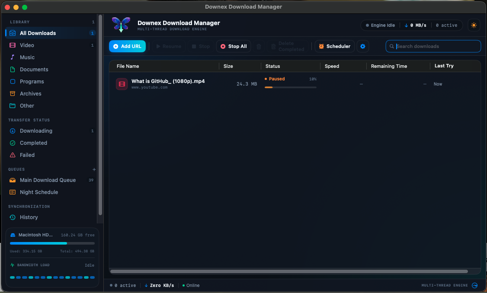
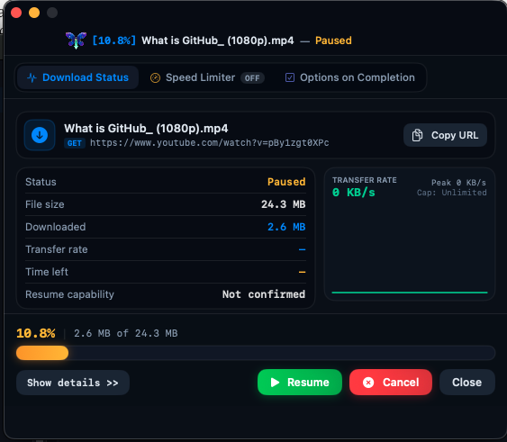
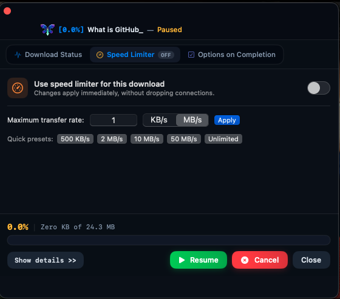
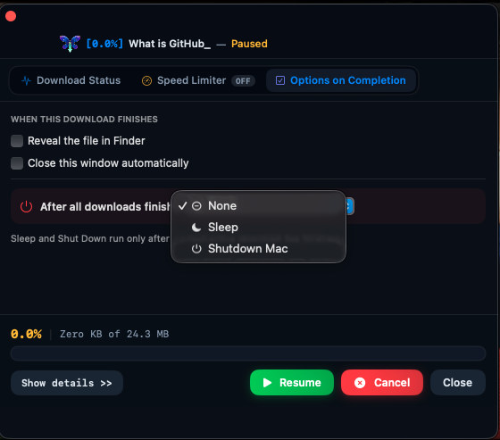
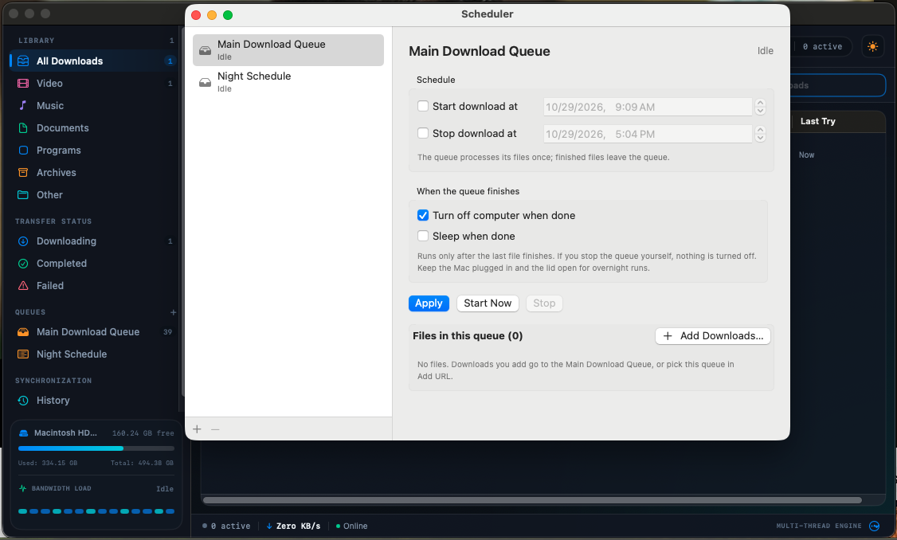

<p align="center">
  
</p>

<h1 align="center">Downix Download Manager</h1>

<p align="center">
  A fast, native download manager for macOS.<br>
  Grab videos from <b>YouTube, Instagram, TikTok, Facebook, X (Twitter), Vimeo, Twitch</b> and 1,000+ other sites, or any file on the web, with multi-connection speed, resume and a browser extension.
</p>

---

<p align="center">
  <br>
  <sub>Library, queues and live transfer status</sub>
</p>

<table>
  <tr>
    <td align="center" width="50%"><br><sub>Live status, progress and resume for each download</sub></td>
    <td align="center" width="50%"><br><sub>Per-download speed limiter, changed live</sub></td>
  </tr>
  <tr>
    <td align="center" width="50%"><br><sub>What happens when a download finishes</sub></td>
    <td align="center" width="50%"><br><sub>Scheduler: start and stop times, sleep or shut down when done</sub></td>
  </tr>
</table>

## What it downloads

- **Videos from popular sites:** YouTube (including Shorts and live), Instagram, TikTok, Facebook, X / Twitter, Vimeo, Dailymotion, Twitch and any other site [yt-dlp](https://github.com/yt-dlp/yt-dlp) supports.
- **Any file:** archives, installers, documents, audio, disk images. Paste a link or let the browser extension catch it.
- **Streams:** HLS (`.m3u8`) and DASH links, merged into a single MP4 with ffmpeg.
- **Quality of your choice:** from 144p up to 4K, or audio only (M4A).

## Features

- **Multi-connection downloads** that split a file into chunks and fetch them in parallel. A built-in watchdog reconnects on its own if a fast download suddenly crawls.
- **Resume anywhere:** pause, cancel and retry, quit the app, or lose your connection. Downloads continue from where they stopped and reconnect automatically.
- **Browser extension** for Brave, Chrome, Edge and Firefox: a slim in-page bar on videos with a quality picker, a right-click "Download with Downix" and a toolbar popup.
- **YouTube codec choice:** AV1 (smaller files), H.264 (most compatible) or Auto.
- **Scheduler and queue:** start downloads later, run them in order, sleep or shut down the Mac when they finish.
- **Speed limiter:** per download or global, changeable live.
- **Proxy support** for the app, yt-dlp and the browser captures.
- **Live progress** in the Dock icon (progress bar and speed) and the menu bar.
- **Check for Updates** from the About tab or the menu-bar menu.

## Download

1. Go to [**Releases**](https://github.com/kms69/Downix/releases/latest) and download `Downix-x.y.z.dmg`.
2. Open the .dmg and drag **Downix** into **Applications**.
3. First launch: macOS will say it can't verify the developer, because the app isn't notarized yet. Open **System Settings, Privacy & Security**, scroll down and click **Open Anyway**. If macOS says the app is damaged, run this once in Terminal and open it again:

```bash
xattr -dr com.apple.quarantine /Applications/Downix.app
```

Requires macOS 13 or later. yt-dlp is downloaded automatically on first use. Install ffmpeg (`brew install ffmpeg`) to merge video and audio.

### Why does macOS show a warning?

Downix isn't notarized by Apple yet. Notarization needs Apple's paid developer program, which I can't afford right now. The warning means Apple hasn't reviewed the app. It isn't a report of a problem with it. Once the project can cover the fee, the warning goes away.

### Browser extension

1. In the app, open **Settings, Browser Integration** and install the native host.
2. Open `chrome://extensions` (or `brave://extensions`, `edge://extensions`), turn on **Developer mode**, click **Load unpacked** and pick the folder shown in the app (it is `Downix Extensions` in your home folder).
3. Firefox: open `about:debugging`, choose **Load Temporary Add-on** and select `manifest.json` inside `~/Downix Extensions/Firefox`.

## Usage

1. **Paste a link** into the app, or click the Downix bar the extension adds over a video.
2. Pick a quality and a folder, then confirm.
3. Watch progress in the window, the Dock icon or the menu bar. Pause, resume, cancel or retry at any time.

## Notes

- Download only content you have the right to save. You are responsible for following each site's terms and the law where you live.
- Links to some sites expire within minutes. If a retry fails, grab the video again from the browser.
- Logs are at `~/Library/Logs/DownloadManager/ytdlp.log`.

## Support the project

If Downix is useful to you, a star on this repo helps other people find it. I plan to add a "Buy Me a Coffee" link soon. The money would go toward Apple's developer fee, so the warning disappears, and toward listing the extension in the Chrome Web Store.

## Feedback and bugs

Open an [issue](https://github.com/kms69/Downix/issues) here. Please include your macOS version and, for download problems, the last lines of `~/Library/Logs/DownloadManager/ytdlp.log`. If you like Downix, a star helps others find it.

## License

Copyright (c) 2026 Kaveh. All rights reserved. Free to use for personal use; please don't redistribute the app or its files.
